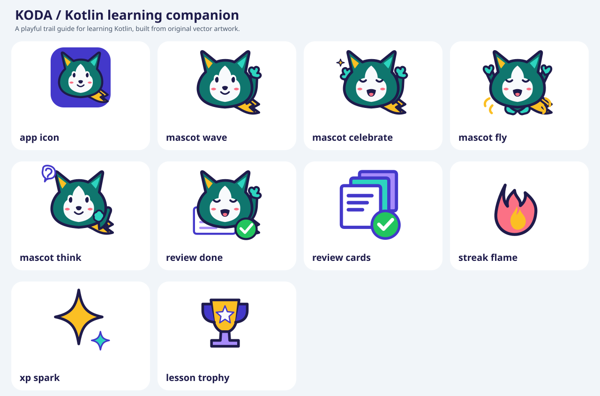

# Koda brand assets

Koda is the friendly fox companion for the Kotlin learning app. The identity uses a rounded teal fox, cream face, indigo outline, and an amber tail marked with a code chevron. The expressive eyes and small smile keep the character readable at launcher and in-app sizes without borrowing another learning brand's mascot.

To regenerate the source SVGs, the vector contact sheet, and Android resources in a repository checkout, run `python3 assets/brand/generate_assets.py`. Edit the shared path geometry in that script so all three formats stay in sync. `preview.png` is a rendered snapshot of the contact sheet; production artwork uses native Android vectors.

## Source artwork

Individual artwork files are transparent SVG vectors except `app_icon.svg`, which includes its indigo rounded-square background. Art uses a 128 × 128 viewBox (the launcher foreground uses 108 × 108), simple fills and strokes, and no raster images, fonts, external references, filters, or scripts. `preview.svg` arranges those vectors on a light contact sheet.

- `mascot_wave.svg`, `mascot_celebrate.svg`, `mascot_fly.svg`, and `mascot_think.svg` — Koda's wave, celebration, airborne streak, and thinking guide poses.
- `review_done.svg` — completion illustration with a lesson card and check badge.
- `review_cards.svg` — compact stacked-card/check mark for review shortcuts.
- `streak_flame.svg`, `xp_spark.svg`, and `lesson_trophy.svg` — matching learning badges.
- `app_icon_foreground.svg`, `app_icon.svg`, and `app_icon_monochrome.svg` — adaptive-icon foreground, full preview, and themed monochrome silhouette.
- `generate_assets.py` — writes the SVGs, vector contact sheet, and matching Android vectors from shared path geometry.

## Android resources

Use `@drawable/brand_mascot_wave`, `@drawable/brand_mascot_celebrate`, `@drawable/brand_mascot_fly`, `@drawable/brand_mascot_think`, `@drawable/brand_review_done`, `@drawable/brand_review_cards`, `@drawable/brand_streak_flame`, `@drawable/brand_xp_spark`, and `@drawable/brand_lesson_trophy` for in-app artwork. The flying pose supports streak milestones, while the thinking pose works as a friendly learning guide. The review shortcut stays bold at 28 dp; use the larger completion art around 112 dp. Adaptive launcher resources are `@mipmap/ic_launcher` and `@mipmap/ic_launcher_round`, with the monochrome foreground supplied on Android 13 and newer. `brand_launcher_background` is the shared indigo adaptive background.

The launcher foreground is 108 dp. Koda is scaled to fit within the centered 66 dp-diameter circle (radius 33 dp), preserving the ears, face, and complete tail under circular and squircle masks. Source artwork and Android VectorDrawables share the same path data; launcher variants use the same mascot geometry and scale.

## Palette

| Color | Hex | Use |
| --- | --- | --- |
| Indigo | `#4338CA` | launcher field, secondary accents |
| Teal | `#0F766E` | Koda |
| Mint | `#2DD4BF` | ear and paw highlights |
| Amber | `#FBBF24` | ears, code tail, achievement highlights |
| Ink | `#1E1B4B` | confident outlines and facial features |
| Cream | `#F8FAFC` | face and light surfaces |
